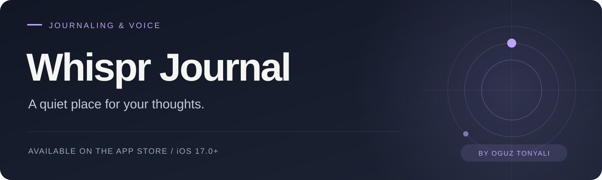
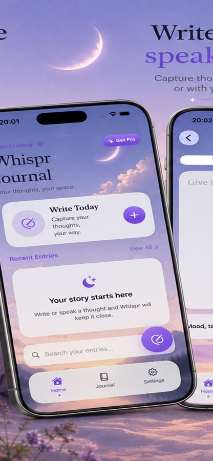
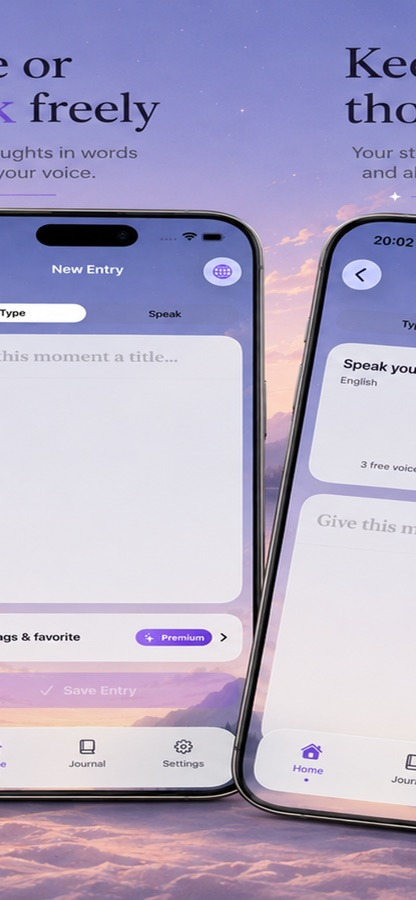

  <a href="https://apps.apple.com/us/app/whispr-journal-voice-diary/id6806876874"><strong>View on the App Store ↗</strong></a> &nbsp; · &nbsp;
  <a href="docs/ENGINEERING.md">Engineering notes</a> &nbsp; · &nbsp;
  <a href="https://github.com/Zodomik">More by Oğuz Tonyalı</a>

## Whispr Journal

A personal journal that lets you write or dictate, then revisit your entries in a book-style reader. Dawn and night themes give everyday reflection a calm visual setting.

Built and published by **[Oğuz Tonyalı](https://github.com/Zodomik)**. This repository is a public product and engineering showcase; the application source is maintained privately.

## A look inside

  
  
  

*Official product previews from the [App Store listing](https://apps.apple.com/us/app/whispr-journal-voice-diary/id6806876874).*

## What you can do

- Text entries and editable voice dictation in six languages.
- Scrollable and paged book-style reading.
- Search, calendar browsing, moods, tags and favorites.
- Premium text export and Journal Lock with device authentication.

## Technology

| Area | Technologies | Role in the product |
| --- | --- | --- |
| Interface | Swift, SwiftUI | Composition, journal browsing, themes and book-style reading. |
| Persistence | SwiftData | Structured journal entries and local data storage. |
| Dictation | Speech, AVFoundation | Speech recognition, microphone capture and recording-session lifecycle. |
| Journal Lock | LocalAuthentication | Device authentication before opening protected journal content. |
| Purchases | RevenueCat, StoreKit | Subscription/lifetime access and purchase restoration. |

## Engineering highlights

### Local persistence as a product decision

SwiftData keeps journal content on the device without requiring a journal account. Entry models support more than plain text: tags, moods and browsing preferences shape the experience.

### Voice capture that stays editable

Speech recognition feeds text into the composition flow, so dictation remains a draft the writer can revise before saving. Audio capture and recognition have distinct lifecycle responsibilities.

### Privacy with precise boundaries

Local journal storage and device authentication serve different needs. Optional Apple dictation may use Apple servers when on-device recognition is unavailable; purchases are handled by Apple and RevenueCat.

→ **[Explore the architecture and design decisions](docs/ENGINEERING.md)**

## Try the product

**[Open Whispr Journal on the App Store](https://apps.apple.com/us/app/whispr-journal-voice-diary/id6806876874)** · Requires iOS 17.0 or later.

Availability and purchase options are shown in the store. For product support, use the developer links on the App Store listing.

---

[All published apps](https://apps.apple.com/us/developer/oguz-tonyali/id1880078720) · [Developer profile](https://github.com/Zodomik) · [Media credits](assets/SOURCES.md)
