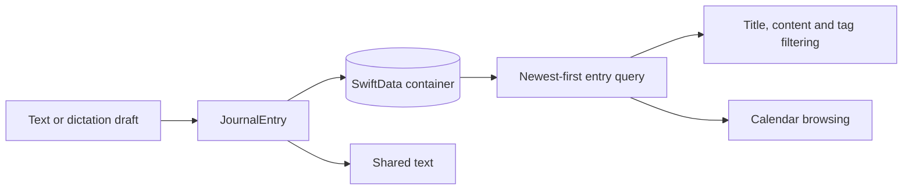

# Whispr Journal · Local data model

The app uses a **SwiftData `JournalEntry` model** in a device-local ModelContainer. It does not have a custom account API or a server journal database.

| Field | Purpose |
| --- | --- |
| id | Unique UUID identity |
| title / content | User-authored entry text |
| createdAt / updatedAt | Creation and modification dates |
| mood | Optional mood value |
| tags | Array of tag strings |
| isFavorite | Favorite marker |
| themeUsedAtCreation | Theme associated with composition |
| languageCode | Dictation/composition language preference recorded with the entry |

## Query and edit flow

The list query sorts by creation time, newest first. Favorite and text filters are applied to those entries. Saving inserts a model and explicitly saves the context. On save failure the composition screen preserves the user’s draft. Deletion also saves explicitly and rolls back on failure.

Tags belong directly to the entry; the app does not define separate tag or join tables in its model. Likewise, favorite state is a field rather than a separate favorites relation.

## Preferences and purchase state

Theme, reading style, selected language and the Journal Lock setting are small preferences outside the entry model. RevenueCat/Apple handle purchase entitlements. A purchase integration is not a cloud journal-sync backend.

There is no explicit cross-device journal synchronization or custom encrypted-column scheme in the reviewed model. The storage description is limited to what the code configures.

[Architecture](ENGINEERING.md) · [Implementation choices](ALGORITHMS.md)
