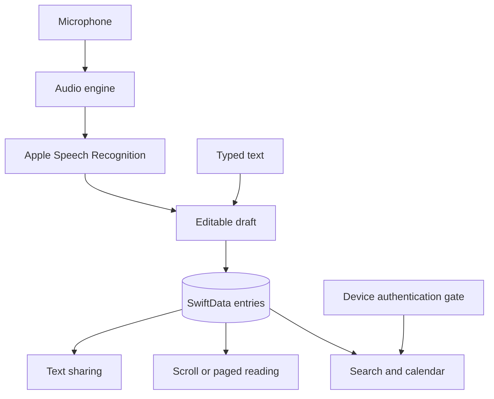

# Whispr Journal · Architecture

*Implementation notes checked against the working project on 20 November 2026. Store builds may differ as the project evolves.*

Whispr is a local journal with optional speech-to-text. It uses Apple platform frameworks for persistence, dictation and device authentication, rather than a custom journal backend.

| Area | Framework / component | Role |
| --- | --- | --- |
| Interface | Swift, SwiftUI | Composition, browsing, calendar and reading modes |
| Database | SwiftData, ModelContainer, ModelContext, Query | Stored entries, sorted retrieval and saves |
| Microphone | AVFoundation, AVAudioEngine | Audio session and buffer capture |
| Transcription | Speech, SFSpeechRecognizer | Partial/final speech recognition and locale selection |
| Access gate | LocalAuthentication, LAContext | Device-owner authentication for Journal Lock |
| Preferences | AppStorage / UserDefaults | Theme, language, reading mode and lock preference |
| Purchases | RevenueCat, StoreKit | Premium subscription/lifetime access |
| Sharing | UIKit, UIActivityViewController | Export an entry through the system share sheet |

## Dictation is part of composition

Speech recognition does not create a final entry directly. Partial transcription is combined with the text already in the draft, and the user can edit before saving. `SpeechRecognizer` owns permission, audio-engine and recognition-task lifecycles.

When supported, the recognition request requires on-device recognition. Otherwise optional dictation can use Apple’s recognition service. Saved journal storage is local, but that is a different boundary from the service used to recognize speech.

## Persistence and reading

The app creates a SwiftData container for `JournalEntry`. Views query entries by creation date and use ModelContext to save changes. Search filters title, content and tags from the fetched entry collection.

Book mode groups words into approximate 700-character chunks and displays them in a paged TabView. Each page can also scroll. This is a lightweight reading presentation, distinct from NovelVerse’s TextKit layout-based pagination.

## Journal Lock

The lock state is initialized from the saved preference. Going to the background locks the app again when the option is enabled. Unlock uses device-owner authentication, which can use the device’s supported biometric/passcode mechanism.

This is an application access gate. The implementation should not be described as a custom encrypted database or end-to-end encrypted journal service.

**Code landmarks:** `JournalEntry`, `SpeechRecognizer`, `AppLockManager`, `JournalListView`, `BookReadingView`, `NewEntryView` and `SubscriptionManager`.

**Continue:** [Local data model](DATA_MODEL.md) · [Implementation choices](ALGORITHMS.md) · [Product](../README.md)
