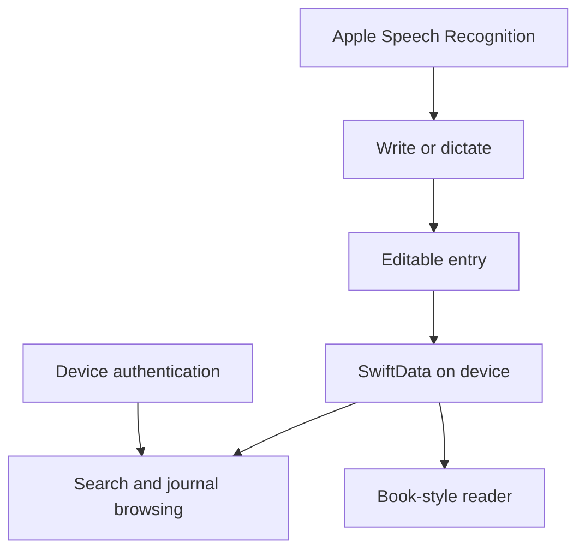

# Whispr Journal · Engineering notes

This overview describes the product’s implementation at a component level. It accompanies the [product showcase](../README.md).

## Component map

The diagram emphasizes responsibilities and data flow. Platform integrations can have their own independent lifecycle.

## Design decisions

### Local persistence as a product decision

SwiftData keeps journal content on the device without requiring a journal account. Entry models support more than plain text: tags, moods and browsing preferences shape the experience.

### Voice capture that stays editable

Speech recognition feeds text into the composition flow, so dictation remains a draft the writer can revise before saving. Audio capture and recognition have distinct lifecycle responsibilities.

### Privacy with precise boundaries

Local journal storage and device authentication serve different needs. Optional Apple dictation may use Apple servers when on-device recognition is unavailable; purchases are handled by Apple and RevenueCat.

## Stack reference

| Area | Technologies | Responsibility |
| --- | --- | --- |
| Interface | Swift, SwiftUI | Composition, journal browsing, themes and book-style reading. |
| Persistence | SwiftData | Structured journal entries and local data storage. |
| Dictation | Speech, AVFoundation | Speech recognition, microphone capture and recording-session lifecycle. |
| Journal Lock | LocalAuthentication | Device authentication before opening protected journal content. |
| Purchases | RevenueCat, StoreKit | Subscription/lifetime access and purchase restoration. |

## Scope

The technology summary was checked against the application’s Swift imports, project configuration and relevant service/model implementations. Backend technologies, where listed, were checked against the associated package manifest and database schema. Store screenshots illustrate the released product; the private working project may continue evolving after release.

This documentation publishes no credentials, deployment configuration, private endpoints or application source. Product behavior and supported devices are described in the [current App Store listing](https://apps.apple.com/us/app/whispr-journal-voice-diary/id6806876874).
